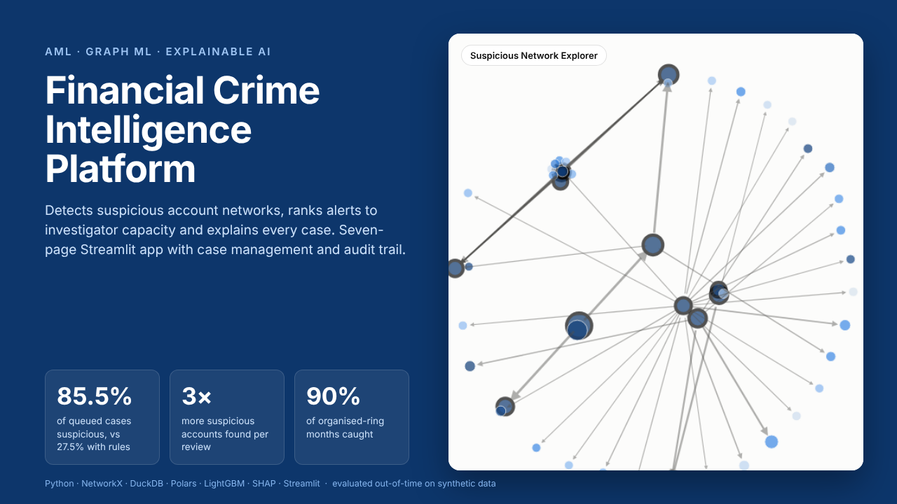
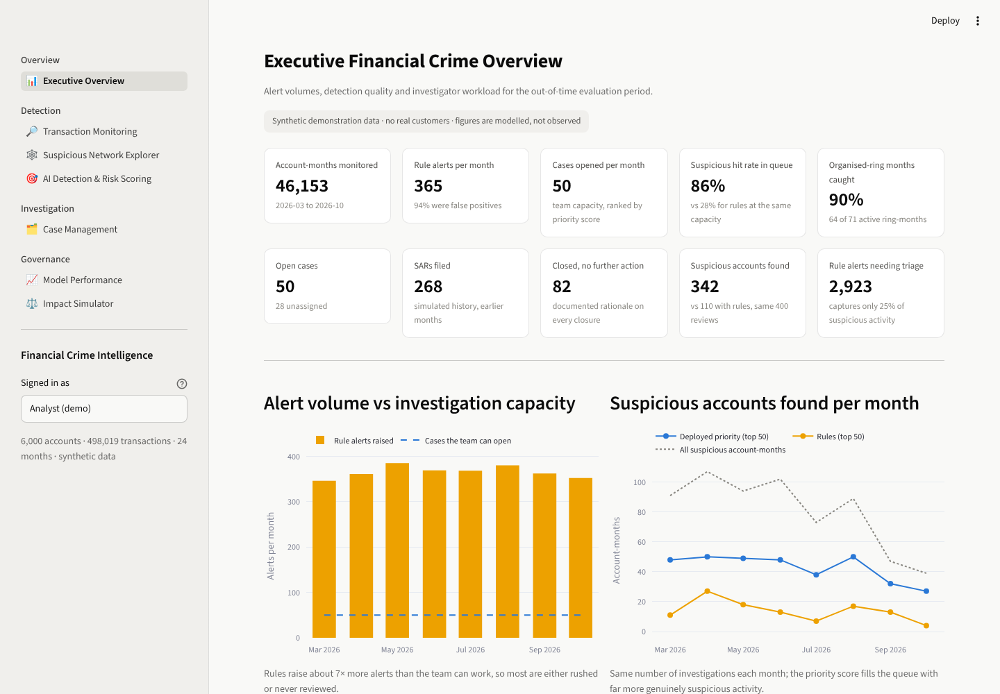
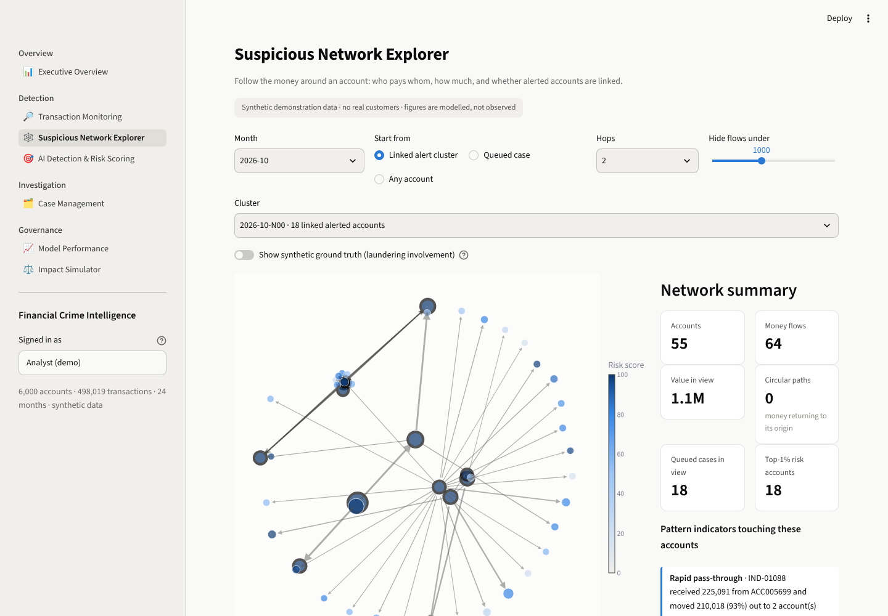
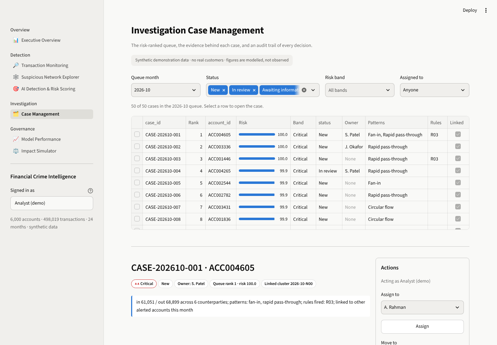
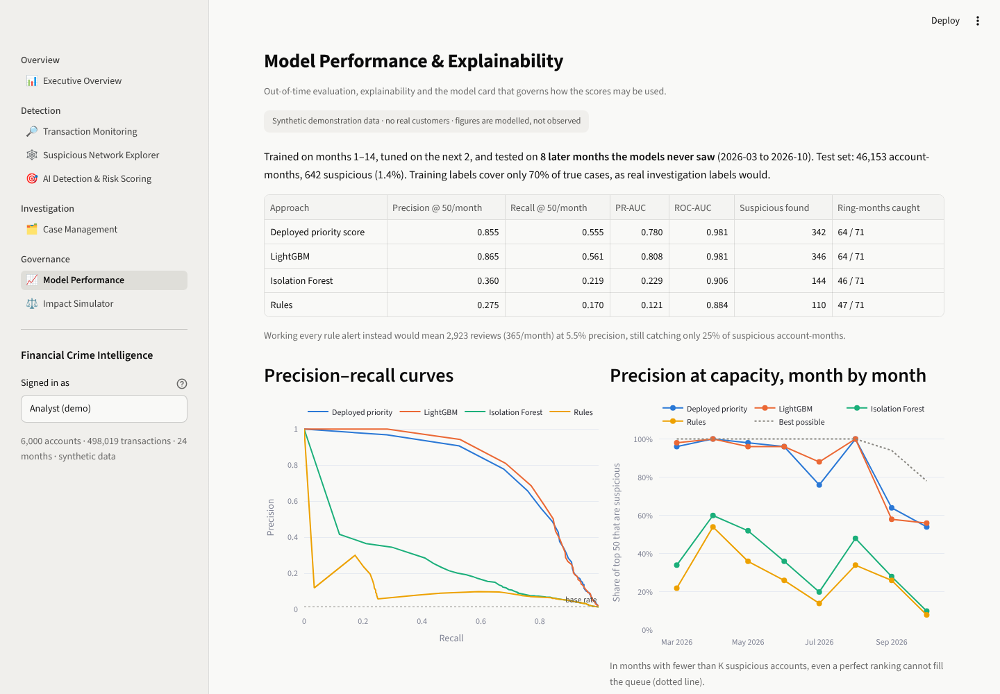
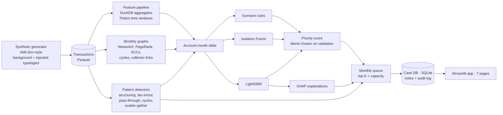

# Financial Crime Intelligence Platform

**AI-powered anti-money-laundering monitoring: suspicious network detection, risk-ranked alerts, explainable investigations.**



Rule-based transaction monitoring raises far more alerts than an AML team can review, most of them false, and it
looks at accounts one at a time. Money laundering is a network activity: funds are split, layered, cycled and
collected across many accounts. This platform analyses the **network of money flows**, ranks suspicious activity
to fit the team's **real investigation capacity**, and shows investigators **why** each case was raised, with a
case-management workflow and a full audit trail.

> All data is synthetic, generated for this project with known ground truth. No real customer or bank data is used.
> Results compare approaches fairly on identical data; they are not a forecast of real-world performance.

---

## Results (out-of-time test, 8 months the models never saw)

46,153 account-months, 642 of them genuinely suspicious (1.4%). Team capacity: 50 investigations per month.

| Approach | Share of queue that is suspicious | Suspicious activity caught | PR-AUC | Organised-ring months caught |
|---|---|---|---|---|
| **Deployed priority score** | **85.5%** | **55.5%** | 0.780 | **64 / 71** |
| LightGBM risk model alone | 86.5% | 56.1% | 0.808 | 64 / 71 |
| Isolation Forest (unsupervised) | 36.0% | 21.9% | 0.229 | 46 / 71 |
| Scenario rules, ranked by rule score | 27.5% | 17.0% | 0.121 | 47 / 71 |

* Working **every** rule alert would mean 2,923 reviews (365 a month, 7× capacity) at 5.5% precision, and still
  catch only 25% of suspicious activity.
* At the same 400 reviews, the priority queue finds **342** suspicious account-months against **110** for rules,
  about **3× the output for the same effort**. Measured per analyst hour, it is 3.5 h per suspicious account found
  against 27 h when every rule alert is triaged.
* The deployed blend (95% LightGBM + 5% Isolation Forest) was chosen on validation months. On the test months it
  scored one point below LightGBM alone (85.5% vs 86.5%). That is reported as found, not tuned away.
* The main gap is fan-in/fan-out "mule" accounts that each move one modest payment (21–40% caught).

## The seven-page application

| | Page | What it is for |
|---|---|---|
| 01 | **Executive Overview** | Alert volume vs capacity, suspicious accounts found, ring coverage, workload, modelled efficiency |
| 02 | **Transaction Monitoring** | Search transactions, scenario-rule hit rates, pattern indicators with plain-English evidence |
| 03 | **Suspicious Network Explorer** | Interactive money-flow graph around an account or a cluster of linked alerts; circular paths |
| 04 | **AI Detection & Risk Scoring** | How rules, anomaly detection and the model rank the same accounts; live SHAP for any account |
| 05 | **Case Management** | Risk-ranked queue, evidence, linked cases, notes, controlled status workflow, audit trail export |
| 06 | **Model Performance** | PR curves, precision at capacity by month, SHAP importance, detector quality, model card |
| 07 | **Impact Simulator** | Change capacity, thresholds, blend weights and rules; see trade-offs; export a policy change record |

| | |
|---|---|
|  |  |
|  |  |

## How it works



**Unit of monitoring: the account-month.** Each active account gets one row per month with ~47 features:

* **Flows:** volumes, counterparties, largest and average transaction, active days, out/in balance
* **Cash and thresholds:** deposits, deposits just under the 10,000 reporting threshold, withdrawals
* **Geography:** cross-border share, high-risk-jurisdiction exposure (placeholder codes HR1–HR3)
* **Velocity:** most counterparties within any 72 hours (fan-out/fan-in bursts), share of outgoing money received in the previous 24 hours (pass-through)
* **Network:** weighted PageRank, size of the strongly connected (circular-flow) component, short cycles, "pays into a collector", "paid by a distributor", high-KYC neighbour share
* **Pattern indicators:** counts of each detected typology touching the account

**Pattern detectors** are investigative indicators, not findings. Each comes with an evidence sentence, e.g.
*"4 cash deposits between 9,040 and 9,310 (just under the 10,000 reporting threshold) within 4 days, total 36,920;
35,800 sent on to ACC002479 3 days later."* Their measured quality:

| Pattern | Indicators | Precision | Schemes recovered |
|---|---|---|---|
| Structuring | 28 | 0.89 | 25 / 25 |
| Rapid pass-through | 340 | 0.61 | 26 / 26 |
| Circular flow (time-respecting cycles) | 192 | 0.33 | 63 / 63 |
| Scatter-gather layering | 30 | 1.00 | 32 / 39 |
| Fan-in | 34 | 0.85 | 27 / 47 |
| Fan-out | 118 | 0.22 | 23 / 38 |

Circular-flow and fan-out detectors also fire on legitimate intercompany treasury loops and payroll-like payments,
which the generator includes on purpose. That is why indicators feed the model as evidence rather than opening
cases by themselves.

## Evaluation design

* **Time-based split.** Train on months 1–14, tune on 15–16, test on 17–24. No shuffling.
* **Incomplete training labels.** Only 70% of truly suspicious account-months are labelled for training, as with
  real SAR-derived labels. Evaluation always uses the full synthetic truth.
* **Precision and recall at capacity.** The question an AML lead actually asks: if we can open K cases a month,
  how many are worth opening, and how much do we miss?
* **Ring coverage.** Share of month-by-month organised-ring activity with at least one involved member in the queue.
* **Deterministic and reproducible.** Same seed gives byte-identical transactions, indicators and scores on a
  given machine, whatever Python's hash seed (checked in CI with `scripts/check_reproducible.py`).

See [docs/model_card.md](docs/model_card.md) for intended use, limitations and monitoring.

## Quick start

```bash
git clone <this-repo> && cd aml-financial-crime-intelligence
python -m venv .venv && source .venv/bin/activate      # Windows: .venv\Scripts\activate
pip install -r requirements-dev.txt

streamlit run app/streamlit_app.py      # uses the committed demo data in data/demo/
pytest -q                               # 36 tests: data, detectors, graph, models, cases, all 7 pages
```

Rebuild everything from scratch (about one minute):

```bash
python scripts/build_demo.py --profile demo
```

Production-scale profile: 100,000 accounts and 5.7 million transactions build end to end in under 10 minutes with
5.1 GB peak memory on a 2-vCPU, 8 GB machine (`--profile full`, see
[technical documentation](docs/technical_documentation.md#10-scaling)).

## Project structure

```
src/amlintel/
  config.py               profiles (demo / test / full) and model settings
  data/generator.py       synthetic accounts, transactions, typologies, benign look-alikes
  data/pipeline.py        account-month features (DuckDB + Polars), labels
  graph/network.py        monthly graphs, graph features, ego networks, alert clustering
  detection/typologies.py pattern detectors + quality evaluation
  detection/rules.py      scenario rules (one reviewable table)
  detection/models.py     Isolation Forest, LightGBM, blend selection, evaluation
  detection/explain.py    SHAP per case and global
  cases/store.py          SQLite case store: workflow, notes, append-only audit log
  cases/queue.py          monthly queue, linked clusters, demo case history
  simulation.py           policy simulator
  build.py                end-to-end build, writes data/<profile>/
app/                      Streamlit app (streamlit_app.py + views/)
tests/                    pytest suite
docs/                     technical documentation, model card, data provenance, deployment, case study
.github/workflows/ci.yml  lint, tests, reproducibility check on Python 3.11 and 3.12
```

## Documentation

* [Technical documentation](docs/technical_documentation.md): architecture, features, algorithms, scaling
* [Model card](docs/model_card.md): intended use, performance, limitations, governance
* [Data provenance](docs/data_provenance.md): how the synthetic data is built and what it does and does not represent
* [Deployment guide](docs/deployment.md): Streamlit Community Cloud and local deployment
* [Case study](docs/case_study.md): the problem, approach and results in plain language

## Tech stack

Python · pandas · Polars · DuckDB · NetworkX · scikit-learn · LightGBM · SHAP · SQLite · Streamlit · Plotly ·
pytest · GitHub Actions
